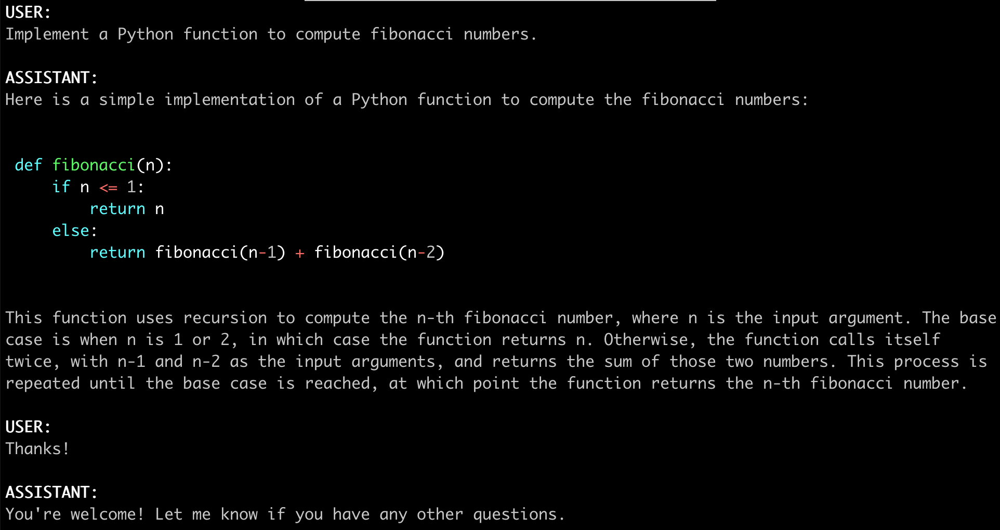
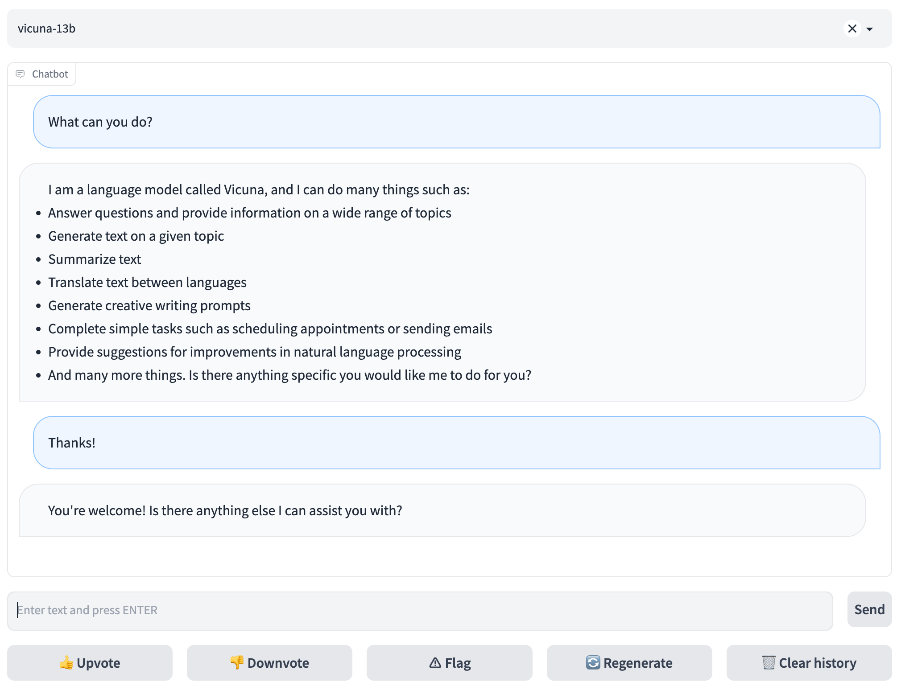

# FastChat
| [**在线演示 (Demo)**](https://lmarena.ai/) | [**Discord**](https://discord.gg/6GXcFg3TH8) | [**X (Twitter)**](https://x.com/lmsysorg) |

<p align="center">
  <a href="README.md">English</a> · <b>简体中文</b>
</p>

FastChat 是一个用于训练、部署和评估基于大语言模型（LLM）的聊天机器人的开源平台。
- FastChat 支撑了 Chatbot Arena（[lmarena.ai](https://lmarena.ai)），为 70 多个大语言模型处理了超过 1000 万次聊天请求。
- Chatbot Arena 通过模型并排对战收集了超过 150 万次真实人类偏好投票，构建了在线 [LLM Elo 竞技场天梯榜](https://lmarena.ai/?leaderboard)。

FastChat 的核心特性包括：
- 前沿模型的训练与评测代码（例如 Vicuna、MT-Bench）。
- 具备 Web UI 与兼容 OpenAI 的 RESTful API 的分布式多模型服务系统。

## 最新动态
- [2024/03] 🔥 我们发布了 Chatbot Arena 技术[报告](https://arxiv.org/abs/2403.04132)。
- [2023/09] 我们开源了 **LMSYS-Chat-1M**，这是一个大规模真实世界 LLM 对话数据集。阅读[报告](https://arxiv.org/abs/2309.11998)。
- [2023/08] 我们发布了基于 Llama 2 的 **Vicuna v1.5**，支持 4K 和 16K 上下文长度。下载[权重](#vicuna-权重)。
- [2023/07] 我们开源了 **Chatbot Arena 对话数据集**，包含 3.3 万条带有人类偏好标注的对话。在此[下载](https://huggingface.co/datasets/lmsys/chatbot_arena_conversations)。

<details>
<summary>更多历史动态</summary>

- [2023/08] 我们发布了基于 Llama 2 的 **LongChat v1.5**，支持 32K 上下文长度。下载[权重](#longchat)。
- [2023/06] 我们推出了 **MT-bench**，一个用于评估聊天机器人的多轮挑战性评测集。查看博客[文章](https://lmsys.org/blog/2023-06-22-leaderboard/)。
- [2023/06] 我们推出了 **LongChat**，长上下文聊天机器人及其评测工具。查看博客[文章](https://lmsys.org/blog/2023-06-29-longchat/)。
- [2023/05] 我们推出了用于 LLM 竞技对战的 **Chatbot Arena**。查看博客[文章](https://lmsys.org/blog/2023-05-03-arena)。
- [2023/03] 我们发布了 **Vicuna：一款达到 ChatGPT 90% 质量并给 GPT-4 留下深刻印象的开源聊天机器人**。查看博客[文章](https://vicuna.lmsys.org)。

</details>

<a href="https://lmarena.ai"></a>

## 目录
- [安装](#安装)
- [模型权重](#模型权重)
- [命令行界面推理](#命令行界面推理)
- [使用 Web GUI 提供服务](#使用-web-gui-提供服务)
- [启动 Chatbot Arena（双模型竞技对战界面）](#启动-chatbot-arena双模型竞技对战界面)
- [API 服务](#api-服务)
- [模型评测](#模型评测)
- [微调](#微调)
- [引用](#引用)

## 安装

### 方式 1：使用 pip

```bash
pip3 install "fschat[model_worker,webui]"
```

### 方式 2：从源码安装

1. 克隆本仓库并进入 FastChat 目录
```bash
git clone https://github.com/lm-sys/FastChat.git
cd FastChat
```

如果在 Mac 上运行：
```bash
brew install rust cmake
```

2. 安装软件包
```bash
pip3 install --upgrade pip  # 启用 PEP 660 支持
pip3 install -e ".[model_worker,webui]"
```

## 模型权重
### Vicuna 权重
[Vicuna](https://lmsys.org/blog/2023-03-30-vicuna/) 基于 Llama 2，应在 Llama 的[模型许可协议](https://github.com/facebookresearch/llama/blob/main/LICENSE)下使用。

你可以使用以下命令开始聊天。它会自动从 Hugging Face 仓库下载权重。
下载的权重会存储在用户主目录下的 `.cache` 文件夹中（例如 `~/.cache/huggingface/hub/<model_name>`）。

有关更多命令选项以及如何处理显存不足问题，请参阅下方的“命令行界面推理”部分。

**注意：16K 版本需要 `transformers>=4.31`。**

| 规格 | 聊天命令 | Hugging Face 仓库 |
| ---  | --- | --- |
| 7B   | `python3 -m fastchat.serve.cli --model-path lmsys/vicuna-7b-v1.5`  | [lmsys/vicuna-7b-v1.5](https://huggingface.co/lmsys/vicuna-7b-v1.5)   |
| 7B-16k   | `python3 -m fastchat.serve.cli --model-path lmsys/vicuna-7b-v1.5-16k`  | [lmsys/vicuna-7b-v1.5-16k](https://huggingface.co/lmsys/vicuna-7b-v1.5-16k)   |
| 13B  | `python3 -m fastchat.serve.cli --model-path lmsys/vicuna-13b-v1.5` | [lmsys/vicuna-13b-v1.5](https://huggingface.co/lmsys/vicuna-13b-v1.5) |
| 13B-16k  | `python3 -m fastchat.serve.cli --model-path lmsys/vicuna-13b-v1.5-16k` | [lmsys/vicuna-13b-v1.5-16k](https://huggingface.co/lmsys/vicuna-13b-v1.5-16k) |
| 33B  | `python3 -m fastchat.serve.cli --model-path lmsys/vicuna-33b-v1.3` | [lmsys/vicuna-33b-v1.3](https://huggingface.co/lmsys/vicuna-33b-v1.3) |

**历史权重**：所有版本的权重及其区别请参阅 [docs/vicuna_weights_version.md](docs/vicuna_weights_version.md)。

### 其他模型
除 Vicuna 外，我们还开源了另外两个模型：[LongChat](https://lmsys.org/blog/2023-06-29-longchat/) 与 FastChat-T5。
你可以使用以下命令与它们对话。程序会自动从 Hugging Face 仓库下载权重。

| 模型 | 聊天命令 | Hugging Face 仓库 |
| ---  | --- | --- |
| LongChat-7B   | `python3 -m fastchat.serve.cli --model-path lmsys/longchat-7b-32k-v1.5`  | [lmsys/longchat-7b-32k](https://huggingface.co/lmsys/longchat-7b-32k-v1.5)   |
| FastChat-T5-3B   | `python3 -m fastchat.serve.cli --model-path lmsys/fastchat-t5-3b-v1.0`  | [lmsys/fastchat-t5-3b-v1.0](https://huggingface.co/lmsys/fastchat-t5-3b-v1.0) |

## 命令行界面推理

<a href="https://lmarena.ai"></a>

（实验性功能：你可以指定 `--style rich` 以启用富文本输出，并在某些非 ASCII 内容上获得更好的流式文本体验。该功能在部分终端上可能无法正常工作。）

#### 支持的模型
FastChat 支持广泛的模型，包括：
LLama 2、Vicuna、Alpaca、Baize、ChatGLM、Dolly、Falcon、FastChat-T5、GPT4ALL、Guanaco、MTP、OpenAssistant、OpenChat、RedPajama、StableLM、WizardLM、xDAN-AI 等。

完整的支持模型列表以及添加新模型的说明请参阅[此处](docs/model_support.md)。

#### 单 GPU
运行以下命令对于 Vicuna-7B 大约需要 14GB 显存，对于 Vicuna-13B 大约需要 28GB 显存。
如果显存不足，请参阅下方的[显存不足](#显存不足)部分。
`--model-path` 可以是本地文件夹路径，也可以是 Hugging Face 仓库名称。
```
python3 -m fastchat.serve.cli --model-path lmsys/vicuna-7b-v1.5
```

#### 多 GPU
你可以使用模型并行将同一台机器上多个 GPU 的显存聚合使用。
```
python3 -m fastchat.serve.cli --model-path lmsys/vicuna-7b-v1.5 --num-gpus 2
```

提示：
有时 huggingface/transformers 中的“auto”设备映射策略无法完全均衡各个 GPU 之间的显存分配。
你可以使用 `--max-gpu-memory` 指定每个 GPU 用于存储模型权重的最大显存。
这样可以为激活值（activations）分配更多显存，从而支持更长的上下文长度或更大的批次大小（batch size）。例如：

```
python3 -m fastchat.serve.cli --model-path lmsys/vicuna-7b-v1.5 --num-gpus 2 --max-gpu-memory 8GiB
```

#### 仅 CPU
仅在 CPU 上运行，不需要 GPU。运行 Vicuna-7B 约需 30GB CPU 内存，运行 Vicuna-13B 约需 60GB CPU 内存。
```
python3 -m fastchat.serve.cli --model-path lmsys/vicuna-7b-v1.5 --device cpu
```

使用 Intel AI 加速器 AVX512_BF16/AMX 加速 CPU 推理：
```
CPU_ISA=amx python3 -m fastchat.serve.cli --model-path lmsys/vicuna-7b-v1.5 --device cpu
```

#### Metal 后端（搭载 Apple Silicon 或 AMD GPU 的 Mac 电脑）
使用 `--device mps` 在 Mac 电脑上启用 GPU 加速（需要 torch >= 2.0）。
使用 `--load-8bit` 开启 8-bit 量化压缩。
```
python3 -m fastchat.serve.cli --model-path lmsys/vicuna-7b-v1.5 --device mps --load-8bit
```
Vicuna-7B 可以在配备 32GB 内存的 M1 Macbook 上以每秒 1 - 2 个词的速度运行。

#### Intel XPU（Intel 数据中心和 Arc A 系列 GPU）
安装 [Intel Extension for PyTorch](https://intel.github.io/intel-extension-for-pytorch/xpu/latest/tutorials/installation.html)。配置 OneAPI 环境变量：
```
source /opt/intel/oneapi/setvars.sh
```

使用 `--device xpu` 启用 XPU/GPU 加速。
```
python3 -m fastchat.serve.cli --model-path lmsys/vicuna-7b-v1.5 --device xpu
```
Vicuna-7B 可以在 Intel Arc A770 16GB 上运行。

#### 华为昇腾 NPU
安装 [Ascend PyTorch Adapter](https://github.com/Ascend/pytorch)。配置 CANN 环境变量：
```
source /usr/local/Ascend/ascend-toolkit/set_env.sh
```

使用 `--device npu` 启用 NPU 加速。
```
python3 -m fastchat.serve.cli --model-path lmsys/vicuna-7b-v1.5 --device npu
```
Vicuna-7B/13B 可以在华为昇腾 NPU 上运行。

#### 显存不足
如果显存不足，可以通过在上述命令中添加 `--load-8bit` 来启用 8-bit 压缩。
这可以在轻微降低模型质量的前提下，将显存占用减半。
该选项兼容 CPU、GPU 和 Metal 后端。

带 8-bit 压缩的 Vicuna-13B 可以在显存为 16 GB 的单卡上运行，例如 Nvidia RTX 3090、RTX 4080、T4、V100 (16GB) 或 AMD RX 6800 XT。

```
python3 -m fastchat.serve.cli --model-path lmsys/vicuna-7b-v1.5 --load-8bit
```

此外，你还可以在上述命令中添加 `--cpu-offloading`，将 GPU 无法容纳的权重卸载（offload）到 CPU 内存中。
这需要启用 8-bit 压缩并安装 bitsandbytes 软件包，该包仅适用于 Linux 操作系统。

#### 更多平台与量化
- 对于 AMD GPU 用户，请在安装 FastChat 之前安装 ROCm 以及 [ROCm 版 PyTorch](https://pytorch.org/get-started/locally/)。另请参阅此[讨论](https://github.com/lm-sys/FastChat/issues/104#issuecomment-1613791563)。
- FastChat 支持 ExLlama V2。参见 [docs/exllama_v2.md](docs/exllama_v2.md)。
- FastChat 支持基于 [GPTQ-for-LLaMa](https://github.com/qwopqwop200/GPTQ-for-LLaMa) 的 GPTQ 4bit 推理。参见 [docs/gptq.md](docs/gptq.md)。
- FastChat 支持基于 [mit-han-lab/llm-awq](https://github.com/mit-han-lab/llm-awq) 的 AWQ 4bit 推理。参见 [docs/awq.md](docs/awq.md)。
- [MLC LLM](https://mlc.ai/mlc-llm/) 基于 [TVM Unity](https://github.com/apache/tvm/tree/unity) 编译器，可通过 Vulkan、Metal、CUDA 和 WebGPU 在手机、消费级 GPU 和 Web 浏览器上原生部署 Vicuna。

#### 使用来自 ModelScope（魔搭社区）的模型
对于中国大陆地区用户，可以通过指定以下环境变量使用来自 www.modelscope.cn 的模型：
```bash
export FASTCHAT_USE_MODELSCOPE=True
```

## 使用 Web GUI 提供服务

<a href="https://lmarena.ai"></a>

要使用 Web UI 提供服务，你需要三个主要组件：面向用户的 Web 服务器、托管一个或多个模型的模型工作节点（Model Worker），以及用于协调 Web 服务器与模型工作节点的控制器（Controller）。你可以在[此处](docs/server_arch.md)了解有关架构的更多信息。

在终端中依次执行以下命令：

#### 启动控制器（Controller）
```bash
python3 -m fastchat.serve.controller
```

控制器负责管理分布式工作节点。

#### 启动模型工作节点（Model Worker）
```bash
python3 -m fastchat.serve.model_worker --model-path lmsys/vicuna-7b-v1.5
```
等待进程加载模型完成并显示“Uvicorn running on ...”。模型工作节点会自动向控制器注册。

为确保模型工作节点已正确连接到控制器，请使用以下命令发送测试消息：
```bash
python3 -m fastchat.serve.test_message --model-name vicuna-7b-v1.5
```
你将看到简短的输出响应。

#### 启动 Gradio Web 服务器
```bash
python3 -m fastchat.serve.gradio_web_server
```

这是用户进行交互的前端界面。

按照上述步骤操作后，你即可使用 Web UI 提供模型服务。现在你可以打开浏览器并与模型对话了。
如果模型列表中未显示模型，请尝试重启 gradio web 服务器。

## 启动 Chatbot Arena（双模型竞技对战界面）

目前，Chatbot Arena 由 FastChat 提供技术支持。以下是在本地启动 Chatbot Arena 实例的方法。

FastChat 支持主流基于 API 的模型，如 OpenAI、Anthropic、Gemini、Mistral 等。若要添加自定义 API，请参阅模型支持[文档](./docs/model_support.md)。下面以 OpenAI 模型为例。

创建一个 JSON 配置文件 `api_endpoint.json`，其中包含你要提供服务的模型的 API 端点，例如：
```
{
    "gpt-4o-2024-05-13": {
        "model_name": "gpt-4o-2024-05-13",
        "api_base": "https://api.openai.com/v1",
        "api_type": "openai",
        "api_key": [Insert API Key],
        "anony_only": false
    }
}
```
对于 Anthropic 模型，使用你的 Anthropic Key 并指定 `"api_type": "anthropic_message"`。类似地，对于 Gemini 模型，指定 `"api_type": "gemini"`。更多详情请参见 [api_provider.py](https://github.com/lm-sys/FastChat/blob/main/fastchat/serve/api_provider.py)。

若要使用本地 GPU 部署你自己的模型，请遵循[使用 Web GUI 提供服务](#使用-web-gui-提供服务)中的说明。

现在即可启动服务器：
```
python3 -m fastchat.serve.gradio_web_server_multi --register-api-endpoint-file api_endpoint.json
```

#### （可选）：进阶功能、扩展性与第三方 UI
- 你可以将多个模型工作节点注册到单个控制器中，用于以更高吞吐量部署单个模型，或同时部署多个模型。这样做时，请为不同的工作节点分配不同的 GPU 和端口。
```
# worker 0
CUDA_VISIBLE_DEVICES=0 python3 -m fastchat.serve.model_worker --model-path lmsys/vicuna-7b-v1.5 --controller http://localhost:21001 --port 31000 --worker http://localhost:31000
# worker 1
CUDA_VISIBLE_DEVICES=1 python3 -m fastchat.serve.model_worker --model-path lmsys/fastchat-t5-3b-v1.0 --controller http://localhost:21001 --port 31001 --worker http://localhost:31001
```
- 你也可以启动多标签页 Gradio 服务器（包含 Chatbot Arena 竞技对战标签页）：
```bash
python3 -m fastchat.serve.gradio_web_server_multi
```
- 基于 huggingface/transformers 的默认模型工作节点具备极佳的兼容性，但在某些场景下速度较慢。如果你需要高吞吐量的批处理服务，可以尝试 [vLLM 集成](docs/vllm_integration.md)。
- 如果你想在自定义 UI 或第三方 UI 上托管，请参阅[第三方 UI](docs/third_party_ui.md)。

## API 服务
### 兼容 OpenAI 的 RESTful API 与 SDK
FastChat 为其支持的模型提供了兼容 OpenAI 的 API，因此你可以将 FastChat 作为本地 OpenAI API 的即插即用替代方案。
FastChat 服务器同时兼容 [openai-python](https://github.com/openai/openai-python) 库与 cURL 命令行。
该 REST API 可以在 Google Colab 免费层中运行，具体演示可见本仓库中的 [FastChat_API_GoogleColab.ipynb](https://github.com/lm-sys/FastChat/blob/main/playground/FastChat_API_GoogleColab.ipynb) Notebook。
详见 [docs/openai_api.md](docs/openai_api.md)。

### Hugging Face Generation API
参见 [fastchat/serve/huggingface_api.py](fastchat/serve/huggingface_api.py)。

### LangChain 集成
参见 [docs/langchain_integration.md](docs/langchain_integration.md)。

## 模型评测
我们使用 MT-bench（一套具有挑战性的多轮开放式问题集）来评估模型。
为了实现评测过程的自动化，我们使用 GPT-4 等强语言模型充当裁判（LLM-as-a-judge），对模型的回复质量进行打分。
运行 MT-bench 的详细说明请参见 [fastchat/llm_judge](fastchat/llm_judge)。

MT-bench 是评估模型的全新推荐方式。如果你仍在寻找 Vicuna 博客文章中使用的旧版 80 道问题，请前往 [vicuna-blog-eval](https://github.com/lm-sys/vicuna-blog-eval)。

## 微调
### 数据

Vicuna 是通过使用从 ShareGPT.com 收集的约 12.5 万条公开用户对话数据，对 Llama 基础模型进行微调而构建的。为确保数据质量，我们将 HTML 转回 Markdown，并过滤掉部分不合规或低质量的样本。此外，我们还将较长对话切分为适应模型最大上下文长度的较短片段。清洗 ShareGPT 数据的详细说明请查看[此处](docs/commands/data_cleaning.md)。

我们不会公开开源 ShareGPT 数据集。如果你想尝试微调代码，可以使用 [dummy_conversation.json](data/dummy_conversation.json) 中的虚拟对话数据进行运行。你可以遵循相同的格式并接入自己的数据。

### 代码与超参数
我们的代码基于 [Stanford Alpaca](https://github.com/tatsu-lab/stanford_alpaca)，并增加了对多轮对话的支持。
我们使用了与 Stanford Alpaca 类似的超参数。

| 超参数 | 全局批次大小 (Global Batch Size) | 学习率 (Learning rate) | 轮数 (Epochs) | 最大长度 (Max length) | 权重衰减 (Weight decay) |
| --- | ---: | ---: | ---: | ---: | ---: |
| Vicuna-13B | 128 | 2e-5 | 3 | 2048 | 0 |

### 使用本地 GPU 微调 Vicuna-7B

- 安装依赖
```bash
pip3 install -e ".[train]"
```

- 你可以使用以下命令在 4 张 A100 (40GB) 上训练 Vicuna-7B。将 `--model_name_or_path` 更新为 Llama 权重的实际路径，并将 `--data_path` 更新为数据的实际路径。
```bash
torchrun --nproc_per_node=4 --master_port=20001 fastchat/train/train_mem.py \
    --model_name_or_path meta-llama/Llama-2-7b-hf \
    --data_path data/dummy_conversation.json \
    --bf16 True \
    --output_dir output_vicuna \
    --num_train_epochs 3 \
    --per_device_train_batch_size 2 \
    --per_device_eval_batch_size 2 \
    --gradient_accumulation_steps 16 \
    --evaluation_strategy "no" \
    --save_strategy "steps" \
    --save_steps 1200 \
    --save_total_limit 10 \
    --learning_rate 2e-5 \
    --weight_decay 0. \
    --warmup_ratio 0.03 \
    --lr_scheduler_type "cosine" \
    --logging_steps 1 \
    --fsdp "full_shard auto_wrap" \
    --fsdp_transformer_layer_cls_to_wrap 'LlamaDecoderLayer' \
    --tf32 True \
    --model_max_length 2048 \
    --gradient_checkpointing True \
    --lazy_preprocess True
```

提示：
- 如果你使用的是 FlashAttention 不支持的 V100 GPU，可以使用 [xFormers](https://github.com/facebookresearch/xformers) 中实现的[内存高效注意力（memory-efficient attention）](https://arxiv.org/abs/2112.05682)。安装 xformers 并将上述 `fastchat/train/train_mem.py` 替换为 [fastchat/train/train_xformers.py](fastchat/train/train_xformers.py)。
- 如果遇到由“FSDP Warning: When using FSDP, it is efficient and recommended... ”引起的显存溢出（OOM），请参阅[此处](https://github.com/huggingface/transformers/issues/24724#issuecomment-1645189539)的解决方案。
- 如果在模型保存期间遇到显存溢出（OOM），请参阅[此处](https://github.com/pytorch/pytorch/issues/98823)的解决方案。
- 要开启对常用实验跟踪工具（如 Tensorboard、MLFlow 或 Weights & Biases）的日志记录，请使用 `report_to` 参数，例如传入 `--report_to wandb` 以开启 Weights & Biases 日志记录。

### 其他模型、平台与 LoRA 支持
有关训练其他模型（例如 FastChat-T5）以及使用 LoRA 的更多说明，请参阅 [docs/training.md](docs/training.md)。

### 使用 SkyPilot 在任意云平台上进行微调
[SkyPilot](https://github.com/skypilot-org/skypilot) 是加州大学伯克利分校（UC Berkeley）开发的一个框架，用于在任何云平台（AWS、GCP、Azure、Lambda 等）上轻松且高性价比地运行机器学习工作负载。
关于如何使用托管竞价型实例（Spot Instances）训练 Vicuna 并节省云上成本，请参阅 [SkyPilot 文档](https://github.com/skypilot-org/skypilot/tree/master/llm/vicuna)。

## 引用
本仓库中的代码（训练、部署与评估）主要针对以下论文开发或衍生自该论文。
如果本仓库对您的研究或工作有所帮助，请引用：

```
@misc{zheng2023judging,
      title={Judging LLM-as-a-judge with MT-Bench and Chatbot Arena},
      author={Lianmin Zheng and Wei-Lin Chiang and Ying Sheng and Siyuan Zhuang and Zhanghao Wu and Yonghao Zhuang and Zi Lin and Zhuohan Li and Dacheng Li and Eric. P Xing and Hao Zhang and Joseph E. Gonzalez and Ion Stoica},
      year={2023},
      eprint={2306.05685},
      archivePrefix={arXiv},
      primaryClass={cs.CL}
}
```

我们还计划向本仓库添加更多我们的研究成果。

---
*注：本文档由社区志愿者维护（贡献者：[@JasonYeYuhe](https://github.com/JasonYeYuhe)），内容与英文官方文档保持同步（更新时间：2026年10月11日）。如有任何疑问或更新建议，欢迎提交 PR 或 Issue。*
